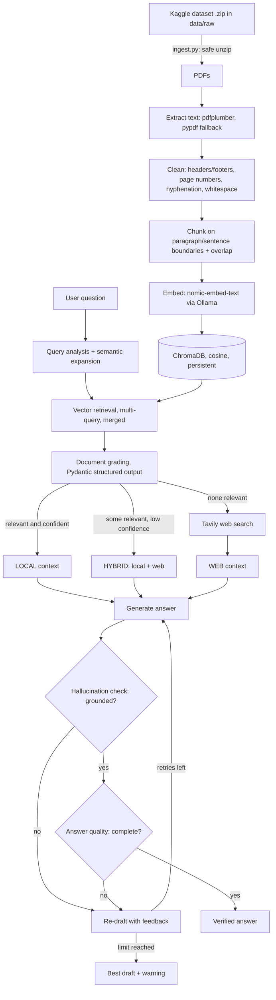

# 🎓 Self-CRAG — Self-Correcting Agentic RAG for a College Syllabus

A fully local question-answering assistant over your syllabus PDFs. It combines:

- **CRAG (Corrective RAG)** — grades the retrieved chunks and falls back to **Tavily web search** when the local context is irrelevant or only partly relevant.
- **Self-RAG-style self-correction** — after drafting an answer it checks for **hallucination** (is every claim grounded in the context?) and **answer quality** (does it really answer the question?), and **re-drafts** until both checks pass or the retry limit is reached.

Everything runs on your laptop (tested design target: **RTX 4050, 6 GB VRAM**) through **Ollama**, with **ChromaDB** as the vector store and **Streamlit** as the UI.

---

## 0. Quick start (for anyone cloning this repo)

> **Dataset:** the PDFs are not in this repository (too large for GitHub). Download the dataset zip from Kaggle: **<ADD YOUR KAGGLE DATASET LINK HERE>**

1. **Install the prerequisites** (once):
   - [Python 3.12](https://www.python.org/downloads/) (3.13+ may lack wheels for some packages)
   - [Ollama](https://ollama.com/download)
   - [Git](https://git-scm.com/downloads)
   - A free [Tavily API key](https://app.tavily.com) (optional; only needed for the web fallback)
2. **Get the code**
   ```bash
   git clone https://github.com/pratyush-vats/self-crag.git
   cd self-crag
   ```
3. **Create the environment and install packages**
   - Windows (PowerShell):
     ```powershell
     py -3.12 -m venv .venv
     .venv\Scripts\Activate.ps1
     python -m pip install -r requirements.txt
     copy .env.example .env
     ```
   - Linux / macOS:
     ```bash
     python3.12 -m venv .venv
     source .venv/bin/activate
     python -m pip install -r requirements.txt
     cp .env.example .env
     ```
4. **Add your Tavily key** to `.env` (`TAVILY_API_KEY=...`). Skip this to run without web fallback.
5. **Download the AI models** (about 15 GB in total)
   ```bash
   ollama pull nomic-embed-text
   ollama pull llama3.1:8b
   ollama pull qwen2.5:14b      # optional: only for Hybrid / Testcase modes
   ```
6. **Add the dataset:** create `data/raw/` and put the downloaded zip inside it.
   - Windows: `mkdir data\raw`  |  Linux/macOS: `mkdir -p data/raw`
7. **Build the knowledge base** (unzips and indexes automatically; takes a while for 230 MB)
   ```bash
   python ingest.py
   ```
8. **Start the app**
   ```bash
   streamlit run app.py
   ```
   Open http://localhost:8501. Keep Ollama running (`ollama serve` if it is not already a background service).

Every later session only needs: activate the venv, then `streamlit run app.py`.

---

## 1. Architecture



ASCII version of the agent loop:

```
question -> analyse -> retrieve -> grade --+--> LOCAL ----------+
                                           +--> HYBRID (+web) --+--> generate -> check
                                           +--> WEB ------------+      ^           |
                                                                       |   fail    v
                                                                       +---- re-draft
```

### Failure handling (every node has a fallback)

| Node | If it fails | Fallback |
|---|---|---|
| Query analysis | LLM / JSON error | use the original question |
| Embedding / ChromaDB | Ollama down, DB missing or empty | treat as empty retrieval → web search |
| Document grading | LLM / JSON error | cosine-similarity threshold |
| Web search | rate limit (429) | exponential backoff, then continue locally |
| Web search | bad API key | disable web search for the session |
| Generation | model missing / out of memory | fall back to `llama3.1:8b`; if everything fails, return an extractive answer |
| Grading model (14B) | not installed / OOM | downgrade to the primary model |
| Verification | LLM / JSON error | mark the answer *unverified*, show a warning |
| No evidence at all | — | abstain instead of guessing |

The mapping is also exposed as `fallback_map` in `config.py`.

---

## 2. Project layout

```
self-crag/
├── config.py            # Pydantic-Settings: all paths, models, thresholds, fallbacks
├── ingest.py            # unzip -> extract -> clean -> chunk -> embed -> ChromaDB
├── agent.py             # CRAG + Self-RAG engine (event generator)
├── app.py               # Streamlit UI with live pipeline visualiser
├── host_global.py       # cross-platform tunnel launcher
├── host_global.sh       # bash tunnel launcher (Linux/macOS/WSL)
├── tests/test_offline.py# tests that need no Ollama / network
├── requirements.txt
├── .env.example
├── .streamlit/config.toml
├── README.md
├── viva_prep.md
└── data/
    ├── raw/             # <- put the dataset .zip here
    └── extracted/       # ingest.py unzips here automatically
```

---

## 3. System requirements

| Item | Requirement |
|---|---|
| OS | Windows 10/11, Linux or macOS |
| Python | 3.12+ |
| GPU | NVIDIA RTX 4050 6 GB (any GPU works; CPU-only is slower) |
| RAM | 16 GB recommended (the 14B model spills into system RAM) |
| Disk | ~20 GB (models ≈ 15 GB + vector store) |
| Ollama | latest, from https://ollama.com/download |

---

## 4. Installation

### 4.1 Ollama models

```bash
ollama pull nomic-embed-text   # embeddings (~270 MB)
ollama pull llama3.1:8b        # primary LLM (~4.9 GB, fits 6 GB VRAM)
ollama pull qwen2.5:14b        # evaluation / testcase LLM (~9 GB, runs partly on CPU)
```

> The task sheet says "`qwen2.5:14b` or `qwen2.4:14b`". There is no Qwen 2.4 release — **`qwen2.5:14b`** is the correct tag. Change it with `EVAL_MODEL` in `.env` if you prefer another model.

### 4.2 Python environment

**Windows (PowerShell)**
```powershell
cd self-crag
python -m venv .venv
.venv\Scripts\Activate.ps1
pip install -r requirements.txt
copy .env.example .env
```

**Linux / macOS**
```bash
cd self-crag
python3.12 -m venv .venv
source .venv/bin/activate
pip install -r requirements.txt
cp .env.example .env
```

Open `.env` and paste your key: `TAVILY_API_KEY=tvly-...` (free key at https://app.tavily.com).

---

## 5. Adding the Kaggle dataset

The dataset (a ~230 MB `.zip`) is **not** stored in the repository.

**Option A — manual (simplest).** Copy the zip into `data/raw/`:
```powershell
mkdir data\raw
copy C:\Users\you\Downloads\syllabus-dataset.zip data\raw\
```
`ingest.py` unzips it into `data/extracted/<zip-name>/` automatically (only PDF/TXT/MD files are extracted, with zip-slip and zip-bomb protection). If you prefer to unzip yourself, extract it anywhere under `data/extracted/` — subfolders are scanned recursively.

**Option B — Kaggle CLI.**
```bash
pip install kaggle                 # put kaggle.json in ~/.kaggle (Windows: C:\Users\you\.kaggle)
kaggle datasets download -d <owner>/<dataset-name> -p data/raw
```

**Option C — browser upload.** In the app sidebar → *Add dataset via browser* (upload limit is set to 1 GB in `.streamlit/config.toml`).

**Option D — inside a Kaggle notebook.** The dataset is already unzipped at `/kaggle/input/<dataset-name>/`; the default `KAGGLE_INPUT_DIR=/kaggle/input` is scanned automatically.

Then build the index:

```bash
python ingest.py            # incremental: unchanged files are skipped
python ingest.py --reset    # wipe and rebuild
```

Re-running is safe: every file is identified by its SHA-256, so only new or changed documents are re-embedded.

---

## 6. Running locally

```bash
ollama serve            # if it is not already running as a service
streamlit run app.py
```

Open http://localhost:8501.

**Sidebar**
- **LLM mode** — ⚡ *Fast* (`llama3.1:8b`), ⚖️ *Hybrid* (8B answers, 14B grades), 🧪 *Testcase* (`qwen2.5:14b` for everything).
- **Self-correction metrics** — hallucination check pass/fail, answer-quality pass/fail, retries used, route taken, every attempt with its unsupported claims.
- **Expanders** — raw retrieved chunks with cosine + grading confidence, and web-fallback sources.
- **Database** — status monitor, *Re-ingest* and *Rebuild* buttons.

**Live pipeline** above every answer: `Parse & Retrieve → Document Grading → Web Fallback → Generation → Self-Correction Check → Output`.

### VRAM notes (RTX 4050, 6 GB)

- `llama3.1:8b` (Q4) ≈ 4.9 GB + ~0.5 GB KV cache at `LLM_NUM_CTX=4096` → fits fully on the GPU. If you see out-of-memory errors, set `LLM_NUM_CTX=3072`.
- `qwen2.5:14b` (Q4) ≈ 9 GB → Ollama automatically offloads roughly half the layers to the CPU. It works but is slower (a few tokens/second), which is why it is reserved for grading and final test cases.
- **Hybrid** mode alternates between two models, so Ollama reloads weights when it switches. Use *Fast* for demos and *Testcase* for the final evaluation.
- Close other GPU programs (browsers with hardware acceleration, games) before using the 14B model.

### Tests (no Ollama or internet needed)

```bash
pip install pytest
pytest -q tests
```

---

## 7. Global hosting

The tunnel exposes your laptop's `localhost:8501`. **Set `APP_PASSWORD` in `.env` first** — anyone with the URL could otherwise use your models and spend your Tavily quota. Your laptop must stay on while the link is shared.

### a) Cloudflare Tunnel (recommended — free HTTPS, no account for quick tunnels)

1. Install `cloudflared`
   - Windows: `winget install --id Cloudflare.cloudflared`
   - macOS: `brew install cloudflared`
   - Linux: download the package from https://developers.cloudflare.com/cloudflare-one/connections/connect-networks/downloads/
2. Run everything with one command:
   ```bash
   python host_global.py                 # Windows / any OS
   ./host_global.sh                      # Linux / macOS / WSL
   ```
   It starts Streamlit (if needed), opens the tunnel and prints a URL like `https://random-words.trycloudflare.com` (also saved to `public_url.txt`).
3. Manual equivalent:
   ```bash
   streamlit run app.py
   cloudflared tunnel --url http://localhost:8501
   ```

Quick tunnels get a new random URL every time. For a permanent URL on your own domain use a *named tunnel* (`cloudflared tunnel login`, `cloudflared tunnel create`, then route DNS) — requires a free Cloudflare account and a domain.

### b) Fallbacks

**ngrok** (free account needed)
```bash
# install from https://ngrok.com/download, then once:
ngrok config add-authtoken <your-token>
python host_global.py --provider ngrok        # or: ngrok http 8501
```

**localtunnel** (needs Node.js)
```bash
python host_global.py --provider localtunnel  # or: npx localtunnel --port 8501
```
Visitors must enter a "tunnel password" — it is your public IP (get it at https://loca.lt/mytunnelpassword).

`python host_global.py` with no arguments tries Cloudflare → ngrok → localtunnel in that order.

### Troubleshooting

| Symptom | Fix |
|---|---|
| `No module named chromadb` (or any package) | the venv is not active or not selected: activate it and run `python -m pip install -r requirements.txt` with that same Python |
| Package install fails on Python 3.13+ | use Python 3.12 (`py -3.12 -m venv .venv`) |
| Self-correction checks fail on every attempt | the 8B model is a weak judge of its own answers: switch to *Hybrid* mode (14B grades), ask narrower questions, and open the *Attempt* expanders to read the judge's reasons |
| `Failed to connect to Ollama` | start Ollama (`ollama serve`) and check `OLLAMA_BASE_URL` |
| PowerShell blocks `Activate.ps1` | run `Set-ExecutionPolicy -Scope CurrentUser RemoteSigned` once |
| Uploads fail with 403 through a tunnel | run `streamlit run app.py --server.enableXsrfProtection=false` (only together with `APP_PASSWORD`) |
| Page loads but chat never answers | Ollama must be running on the host laptop; check the sidebar status lights |
| `Embedding model ... is not installed` | `ollama pull nomic-embed-text` |
| `No PDFs found` | the zip must be in `data/raw/`, or PDFs under `data/extracted/` |
| "No extractable text" warning | the PDF is a scan; OCR is not included (run it through `ocrmypdf` first) |
| Out-of-memory on the 14B model | use *Fast* mode, or lower `LLM_NUM_CTX` |

---

## 8. Configuration reference (`.env`)

| Variable | Default | Meaning |
|---|---|---|
| `TAVILY_API_KEY` | – | enables web fallback |
| `PRIMARY_MODEL` | `llama3.1:8b` | everyday LLM |
| `EVAL_MODEL` | `qwen2.5:14b` | grading / testcase LLM |
| `LLM_MODE` | `fast` | `fast`, `hybrid`, `rigor` |
| `EMBEDDING_MODEL` | `nomic-embed-text` | Ollama embedding model |
| `DATA_DIR` | `data` | dataset root |
| `KAGGLE_INPUT_DIR` | `/kaggle/input` | extra scan root for Kaggle notebooks |
| `CHROMA_DIR` | `chroma_db` | persistent vector store |
| `CHUNK_SIZE` / `CHUNK_OVERLAP` | 1000 / 150 | characters |
| `RETRIEVAL_TOP_K` | 6 | chunks per query |
| `SIMILARITY_THRESHOLD` | 0.45 | heuristic fallback for grading |
| `CONFIDENCE_THRESHOLD` | 0.55 | below this a relevant chunk set is "ambiguous" → hybrid |
| `MAX_CORRECTION_RETRIES` | 2 | self-correction re-drafts |
| `OLLAMA_TIMEOUT_S` / `WEB_TIMEOUT_S` | 240 / 20 | timeouts |
| `APP_PASSWORD` | – | password gate for the app |

---

## 9. Pushing to GitHub

```bash
cd self-crag
git init
git add .
git status                      # make sure .env, data/ and chroma_db/ are NOT listed
git commit -m "Self-CRAG: self-correcting agentic RAG for syllabus Q&A"
git branch -M main
# create an empty repo on github.com first, then:
git remote add origin https://github.com/pratyush-vats/self-crag.git
git push -u origin main
```

- `.gitignore` already excludes `.env`, `data/`, `chroma_db/` and `*.zip`. **GitHub rejects files over 100 MB**, so never commit the dataset — tell readers to download it from Kaggle (Section 5).
- If you ever commit `.env` by mistake, **rotate your Tavily key** — removing the file later does not remove it from history.

---

## 10. How the self-correction works (short version)

1. Each judgement is a **Pydantic model** (`DocumentGrade`, `GroundednessGrade`, `AnswerGrade`). The JSON schema is sent to Ollama's `format` parameter so the output is constrained to valid JSON, then validated with `model_validate_json`; invalid output triggers a retry.
2. **Groundedness** grader receives *context + answer* and lists unsupported claims.
3. **Answer-quality** grader receives *question + answer* and lists missing points.
4. If either fails, the failures are fed back into the next draft prompt ("remove these unsupported claims, cover these missing points"). An incomplete answer also triggers the web fallback once.
5. After `MAX_CORRECTION_RETRIES` the best-scoring draft is returned with a visible warning rather than hidden failure.

See `viva_prep.md` for the full viva question bank.
